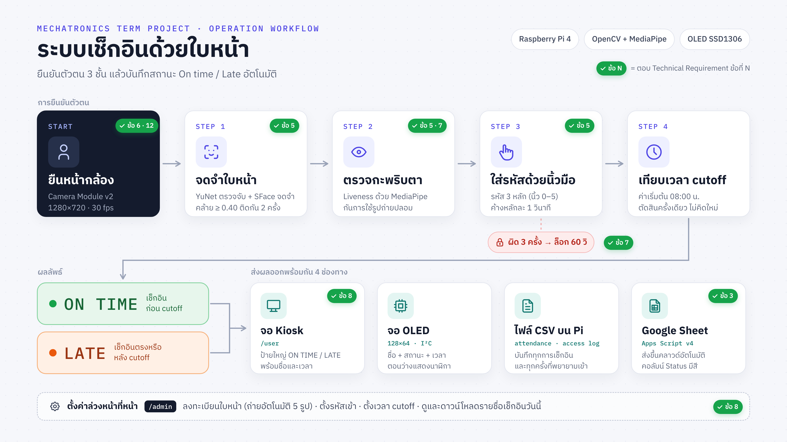

# รายงานโครงงาน Mechatronics: ระบบเช็กอินด้วยใบหน้าบน Raspberry Pi

| รายการ | รายละเอียด |
| --- | --- |
| รายวิชา | Mechatronics 2570 (Term Project) |
| ผู้จัดทำ | รหัส 6630191921 · รหัส 6630242221 |
| บอร์ด | Raspberry Pi 4 Model B 4GB + Camera Module v2 + LeafHAT (จอ OLED SSD1306) |

**บทคัดย่อ** โครงงานนี้สร้างตู้เช็กอินเข้างานอัตโนมัติบน Raspberry Pi 4 ที่ยืนยันตัวตนสามชั้น ได้แก่ จดจำใบหน้า ตรวจการกะพริบตาเพื่อกันการใช้รูปถ่าย และใส่รหัส 3 หลักด้วยการชูนิ้วมือ เมื่อผ่านครบ ระบบจะเทียบเวลากับเวลาตัด (ค่าเริ่มต้น 08:00 น.) แล้วบันทึกสถานะ On time หรือ Late ลงไฟล์ CSV บน Pi และส่งขึ้น Google Sheet พร้อมแสดงผลบนหน้าเว็บ kiosk และจอ OLED ที่ต่อกับบอร์ด ระบบทั้งหมดประมวลผลบน Pi เครื่องเดียว ใช้ Python ร่วมกับ OpenCV และ MediaPipe และเริ่มทำงานเองเมื่อเปิดเครื่อง

## สารบัญ

1. [ที่มาและความสำคัญของโครงงาน](#1-ที่มาและความสำคัญของโครงงาน)
2. [ทฤษฎีและงานที่เกี่ยวข้อง](#2-ทฤษฎีและงานที่เกี่ยวข้อง)
3. [แผนภาพรวมของระบบ](#3-แผนภาพรวมของระบบ)
4. [รายการอุปกรณ์ สเปก และราคา](#4-รายการอุปกรณ์-สเปก-และราคา)
5. [ไฟล์โค้ดในโปรเจกต์ (แบ่งตามประเภท)](#5-ไฟล์โค้ดในโปรเจกต์-แบ่งตามประเภท)
6. [การติดตั้งและทดสอบ](#6-การติดตั้งและทดสอบ)
7. [เอกสารอ้างอิง](#เอกสารอ้างอิง)

## 1. ที่มาและความสำคัญของโครงงาน

การเช็กชื่อเข้างานหรือเข้าเรียนด้วยการเซ็นชื่อหรือการ์ดใช้เวลามากและทุจริตได้ง่าย เช่น เซ็นแทนกันหรือยืมบัตรไปแตะแทน ส่วนเครื่องสแกนใบหน้าแบบง่ายบางรุ่นก็ถูกหลอกได้ด้วยรูปถ่าย โครงงานนี้จึงออกแบบระบบเช็กอินที่ไม่ต้องสัมผัสอุปกรณ์ ยืนยันตัวตนหลายชั้น และบันทึกเวลาเข้างานพร้อมสถานะมาสายโดยอัตโนมัติ

ปัญหาที่ต้องการแก้:

- **การเช็กชื่อแทนกัน:** บัตรหรือลายเซ็นยืมกันได้ แต่ใบหน้ายืมไม่ได้
- **การหลอกด้วยรูปถ่าย:** ต้องตรวจว่าเป็นคนจริง (liveness) ด้วยการกะพริบตา
- **คนหน้าคล้ายหรือระบบจำผิด:** เพิ่มรหัส 3 หลักที่ใส่ด้วยท่ามือ ไม่ต้องแตะแป้นกดที่ใช้ร่วมกัน
- **งานสรุปผลด้วยมือ:** ระบบตัดสิน On time / Late และส่งขึ้น Google Sheet ทันที ผู้ดูแลดูผลได้จากทุกที่

โครงงานนี้แสดงความท้าทายด้าน Mechatronics คือการรวมเซนเซอร์ (กล้อง) ตัวประมวลผล (Raspberry Pi) และอุปกรณ์แสดงผล (OLED) ให้ทำงานแบบเรียลไทม์บนบอร์ดตัวเดียว ข้อดีของ Raspberry Pi คือรันโมเดล AI ด้านภาพ เว็บเซิร์ฟเวอร์ และการส่งข้อมูลขึ้นคลาวด์ได้พร้อมกัน โดยไม่ต้องพึ่งคอมพิวเตอร์ภายนอก

**วัตถุประสงค์**

1. สร้างระบบเช็กอินที่ยืนยันตัวตน 3 ชั้น (ใบหน้า · กะพริบตา · รหัสนิ้ว) บน Raspberry Pi เพียงเครื่องเดียว
2. ตัดสินสถานะ On time / Late จากเวลาตัดที่ผู้ดูแลตั้งเองได้
3. แสดงผลบนจอ kiosk และ OLED บันทึกลง CSV และส่งขึ้น Google Sheet อัตโนมัติ
4. ให้ระบบเริ่มทำงานเองเมื่อเปิดเครื่อง และกลับมาทำงานต่อได้เองเมื่อโปรแกรมส่วนใดส่วนหนึ่งล้ม

## 2. ทฤษฎีและงานที่เกี่ยวข้อง

ระบบนี้ใช้โมเดล AI ด้านภาพ 4 ตัวที่ออกแบบมาให้ทำงานบนอุปกรณ์เล็ก แต่ละตัวรับผิดชอบหนึ่งชั้นของการยืนยันตัวตน

### 2.1 การตรวจจับใบหน้า: YuNet

YuNet เป็นตัวตรวจจับใบหน้าแบบ anchor-free ขนาดเล็กที่ออกแบบมาสำหรับอุปกรณ์ edge โดยเฉพาะ ([Wu, Peng & Yu, 2023](https://link.springer.com/article/10.1007/s11633-023-1423-y)) โมเดลใน OpenCV Zoo ได้ค่า AP 0.834 / 0.824 / 0.708 บนชุดทดสอบ WIDER Face (easy / medium / hard) ([OpenCV Zoo](https://huggingface.co/opencv/face_detection_yunet)) ในโครงงานนี้เรียกผ่าน `cv2.FaceDetectorYN` บนภาพที่ย่อเหลือกว้าง 320 px เพื่อให้เร็วพอบน Pi 4

### 2.2 การจดจำใบหน้า: SFace

SFace เป็นโมเดลที่แปลงใบหน้าเป็นเวกเตอร์คุณลักษณะ (embedding) 128 มิติ ฝึกด้วย loss ที่บังคับเวกเตอร์ให้อยู่บนผิวทรงกลม (hypersphere) และควบคุม gradient ด้วยฟังก์ชัน sigmoid เพื่อลด overfitting จากภาพคุณภาพต่ำ ([Zhong et al., 2022](https://arxiv.org/abs/2205.12010)) การเทียบใบหน้าสองใบจึงใช้ cosine similarity:

$$
\text{sim}(a,b) = \frac{a \cdot b}{\lVert a \rVert \, \lVert b \rVert}
$$

ระบบยอมรับว่าเป็นคนเดียวกันเมื่อ sim ≥ 0.40 ติดกัน 2 ครั้ง (สูงกว่าค่า 0.363 ที่ OpenCV แนะนำ เพื่อลดการจำผิดคน) และตอนลงทะเบียนจะปฏิเสธใบหน้าที่คล้ายคนอื่นเกิน 0.50

### 2.3 การตรวจว่าเป็นคนจริง: การกะพริบตา

งานคลาสสิกของ [Soukupová & Čech (2016)](https://vision.fe.uni-lj.si/cvww2016/proceedings/papers/05.pdf) แสดงว่าจุด landmark บนใบหน้าแม่นพอจะประเมินการเปิด-ปิดตาและตรวจการกะพริบได้แบบเรียลไทม์ โครงงานนี้ใช้แนวคิดเดียวกัน แต่ใช้คะแนน blendshape ของ [MediaPipe Face Landmarker](https://ai.google.dev/edge/mediapipe/solutions/vision/face_landmarker) ซึ่งให้ค่าความหลับตาตั้งแต่ 0 (เปิด) ถึง 1 (ปิด) โดยตรง ระบบนับว่ากะพริบเมื่อคะแนนสูงกว่าระดับตาเปิดปกติของคนนั้นอย่างน้อย 0.16 (และสูงกว่า 0.30) แล้วกลับลงมา ส่วนรูปถ่ายมีคะแนนคงที่ต่ำกว่า 0.1 จึงผ่านไม่ได้

### 2.4 การนับนิ้วมือ: MediaPipe Hands

[MediaPipe Hands](https://arxiv.org/abs/2006.10214) ใช้สองโมเดลต่อกัน คือ palm detector หาตำแหน่งฝ่ามือ และ hand landmark model ทำนายจุดโครงมือ 21 จุด ([Zhang et al., 2020](https://arxiv.org/abs/2006.10214)) โครงงานนี้นำจุด 3D มาคำนวณความตรงของนิ้ว (ระยะตรงโคน-ปลาย ÷ ความยาวตามข้อ) และระยะปลายนิ้วจากข้อมือ เกณฑ์ปรับจากข้อมูลมือที่บันทึกไว้ประมาณ 1,400 เฟรม นิ้วที่ชูต้องตรง ≥ 0.85 และยื่นออกไป ≥ 1.10 เท่า

### 2.5 งานที่เกี่ยวข้อง

| งาน | วิธี | สิ่งที่โครงงานนี้เพิ่ม |
| --- | --- | --- |
| [Hasban et al., APACE 2019](https://update.library.uitm.edu.my/Record/2-s2.0-85082462343/Description) | กล้อง night vision บน Raspberry Pi ติดที่ประตูห้องเรียน | ตรวจ liveness และรหัสท่ามือ |
| [IIUM: Class attendance using face recognition](https://cendekia.unisza.edu.my/neuaxis-e/Record/iium-70809/Details) | Pi + กล้อง + จอ 5 นิ้ว ใช้ LBP | ใช้ deep learning (YuNet + SFace) แทน LBP |
| [Bin Hamed & Fatnassi, JTDE](https://jtde.telsoc.org/index.php/jtde/article/view/530) | HOG + SVM และเว็บแอปควบคุมกล้อง | เช็กอินเองแบบ kiosk ไม่ต้องมีผู้สั่งการ |

งานเหล่านี้ส่วนใหญ่ใช้การจดจำใบหน้าอย่างเดียว โครงงานนี้เพิ่มการตรวจคนจริง รหัสท่ามือแบบไม่สัมผัส และการตัดสิน On time / Late ที่ส่งขึ้น Google Sheet ทันที

## 3. แผนภาพรวมของระบบ

ระบบแบ่งเป็น Input → Processing → Output กล้องเป็นเซนเซอร์เพียงตัวเดียว Raspberry Pi 4 ประมวลผลทั้งหมด และผลลัพธ์ออกทางจอ OLED บนบอร์ด LeafHAT และทาง Wi-Fi (หน้าเว็บ kiosk และ Google Sheet) ผู้ใช้เห็นผลแล้วทำขั้นต่อไป จึงเป็นระบบปิด (closed loop) ที่มีคนอยู่ในวงรอบ

### 3.1 วงจรเชื่อมต่อ (Interface circuits)

| จาก | ไป | Interface | สายสัญญาณ / ขา |
| --- | --- | --- | --- |
| Camera Module v2 | Raspberry Pi 4 (ช่อง CAMERA) | MIPI CSI-2 ผ่านสายแพ (ribbon cable) | สัญญาณภาพดิจิทัล + I²C ควบคุมกล้อง |
| Raspberry Pi 4 | LeafHAT (INEX) | GPIO 40 pin เสียบซ้อนบนบอร์ด | ไฟเลี้ยง 3.3V/5V, GND และสัญญาณทุกขา |
| LeafHAT | จอ OLED SSD1306 128×64 | I²C bus 1 ที่อยู่ 0x3C | SDA = GPIO2 (pin 3), SCL = GPIO3 (pin 5), VDD, GND |
| Adapter | Raspberry Pi 4 (POWER IN) | USB-C | 5V DC |
| Raspberry Pi 4 | เบราว์เซอร์ / Google Sheet | Wi-Fi | HTTP :8000 และ HTTPS POST |


*ภาพที่ 1 แผนผังการต่อสาย (wiring diagram)*

### 3.2 ระบบกลไก

- **การติดตั้งกล้อง:** กล้องติดกลับหัว โปรแกรมแก้ด้วย `Transform(vflip=1)` แทนการหมุนกล้องทางกล
- **การประกอบบอร์ด:** LeafHAT เสียบซ้อนบน header 40 pin ของ Pi จึงไม่ต้องเดินสายจัมเปอร์
- **การระบายความร้อน:** Pi 4 ทำงานที่ประมาณ 63 °C ขณะรันโมเดล ควรเพิ่ม heatsink หรือพัดลม

### 3.3 ขั้นตอนการทำงาน

1. ผู้ใช้ยืนหน้ากล้อง ระบบตรวจจับและจดจำใบหน้า (YuNet + SFace)
2. ระบบขอให้กะพริบตาเพื่อยืนยันว่าเป็นคนจริง (MediaPipe Face Landmarker)
3. ผู้ใช้ชูนิ้วแสดงรหัส 3 หลัก ทีละหลัก ค้างไว้หลักละ 1 วินาที (ผิด 3 ครั้งถูกล็อก 60 วินาที)
4. เมื่อผ่านครบ ระบบเทียบเวลากับเวลาตัด แล้วแสดง **ON TIME** หรือ **LATE** บนหน้าเว็บและจอ OLED บันทึกลง CSV และส่งขึ้น Google Sheet



*ภาพที่ 2 ขั้นตอนการเช็กอินตั้งแต่ยืนหน้ากล้องจนถึงผล On time / Late*

**หน้าเว็บ (พอร์ต 8000)**

| URL | หน้าที่ |
| --- | --- |
| `http://<pi>:8000/user` | หน้าจอ kiosk (1920×1080) แสดงภาพกล้องสดและคำแนะนำทีละขั้น |
| `http://<pi>:8000/admin` | ลงทะเบียนคน (รหัส + ชื่อ, ถ่ายอัตโนมัติ 5 รูป) ลบคน ตั้งรหัสเข้า ตั้งเวลา **Late after** ดูรายชื่อเช็กอินวันนี้ (พร้อม On time / Late) รีเซ็ต และดาวน์โหลด CSV |

## 4. รายการอุปกรณ์ สเปก และราคา

ต้นทุนฮาร์ดแวร์รวมประมาณ 5,500 บาท (ไม่รวม microSD) ราคาอ้างอิงจากร้านค้าในไทย ณ วันที่ 18 พ.ย. 2569 ซอฟต์แวร์ทั้งหมดเป็น open source ไม่มีค่าใช้จ่าย

| # | อุปกรณ์ | สเปกหลัก | จำนวน | ราคา (บาท) | แหล่งราคา |
| --- | --- | --- | --- | --- | --- |
| 1 | Raspberry Pi 4 Model B 4GB | Broadcom BCM2711 Cortex-A72 4 คอร์ 1.5 GHz, RAM 4 GB, Wi-Fi 2.4/5 GHz, GPIO 40 ขา, CSI | 1 | 3,565 (3,331.78 + VAT 7%) | [element14 Thailand](https://th.element14.com/raspberry-pi/rpi4-modbp-4gb/rpi-computer-rpi-4-mod-b-4gb-1/dp/3051887) |
| 2 | Raspberry Pi Camera Module V2 | Sony IMX219 8 MP, 3280×2464, 1080p30 / 720p60, CSI-2 สาย 15 cm, 25×23×9 mm | 1 | 777 (รวม VAT) | [RS Components Thailand](https://th.rs-online.com/web/p/products/9132664/) |
| 3 | LeafHAT บอร์ด GPIO (INEX) | บอร์ด HAT 65×56 mm เสียบ GPIO 40 ขา มีจอ OLED SSD1306 128×64 (I²C 0x3C) และจุดต่อ JST | 1 | 856 (รวม VAT) | [INEX](https://inex.co.th/home/product/leafhat-gpio/) |
| 4 | Raspberry Pi 15W USB-C Power Supply | 5.1 V / 3.0 A, สาย 1.5 m, อินพุต 100–240 VAC | 1 | ประมาณ 310 (US$9.60) | [MCCI](https://store.mcci.com/products/raspberry-pi-15w-usb-c-power-supply) · [สเปก](https://raspberrypi.com/products/type-c-power-supply) |
| 5 | microSD card | 32 GB ลง Raspberry Pi OS 64-bit (Debian 13) | 1 | — | — |
|  | **รวม** |  |  | **≈ 5,508 + microSD** |  |

ราคา LeafHAT เป็นราคาหน้าเว็บ INEX ซึ่งขณะนี้แสดงว่าสินค้าหมด ส่วนราคา adapter แปลงจากดอลลาร์จึงเป็นค่าประมาณ

**ซอฟต์แวร์ที่ใช้ (ฟรี):** Raspberry Pi OS (Debian 13), Python 3.13 (โปรแกรมหลัก) และ 3.12 (worker), picamera2, OpenCV 4.10, MediaPipe 0.10.18, NumPy, luma.oled 3.16, Google Apps Script

## 5. ไฟล์โค้ดในโปรเจกต์ (แบ่งตามประเภท)

โค้ดทั้งหมดประมาณ 2,700 บรรทัด ทุกไฟล์มี docstring และคอมเมนต์กำกับ โปรแกรมหลักรันด้วย Python 3.13 ของระบบ (มี picamera2) ส่วนงานภาพหนักๆ แยกไปรันใน venv Python 3.12 เพราะ MediaPipe 1.x ใช้บน Pi 4 ไม่ได้

```
.
├── camera_stream.py            ← จุดเริ่มต้นโปรแกรม
├── checkin/                    ← โมดูลหลักของระบบเช็กอิน
│   ├── config.py  flow.py  faces.py  hands.py
│   └── storage.py  web.py  workers.py
├── face_worker.py              ← worker ภาพ (Python 3.12)
├── gesture_worker.py
├── oled_worker.py
├── user_page.html              ← หน้าเว็บ
├── admin_page.html
├── google_sheet_apps_script.gs ← ฝั่ง Google Sheet
├── camera-stream.service       ← systemd service
├── tests/                      ← unit test
├── wiring diagram.jpeg         ← รูปประกอบ
└── workflow.png
```

### 5.1 โปรแกรมหลัก (Python 3.13, process หลัก)

| ไฟล์ | หน้าที่ | บรรทัด |
| --- | --- | --- |
| [`camera_stream.py`](camera_stream.py) | จุดเริ่มต้น: เปิดกล้อง สร้าง thread เริ่ม worker และเว็บเซิร์ฟเวอร์ | 77 |
| [`checkin/config.py`](checkin/config.py) | ค่าตั้งและเกณฑ์ทั้งหมด (ความคล้ายใบหน้า เกณฑ์กะพริบตา เวลาตัดเริ่มต้น ฯลฯ) | 86 |
| [`checkin/flow.py`](checkin/flow.py) | ขั้นตอน ใบหน้า → กะพริบตา → รหัส → ผล (state machine) และตัดสิน On time / Late | 194 |
| [`checkin/faces.py`](checkin/faces.py) | ติดตามใบหน้า ลงทะเบียน ตรวจกะพริบตา | 304 |
| [`checkin/hands.py`](checkin/hands.py) | แปลงจำนวนนิ้วเป็นตัวเลขรหัส | 64 |
| [`checkin/storage.py`](checkin/storage.py) | ฐานข้อมูลใบหน้า รหัส (salted hash) เวลาตัด (`Schedule`) ไฟล์ CSV และตัวส่ง Google Sheet | 300 |
| [`checkin/web.py`](checkin/web.py) | HTTP server, MJPEG stream และ REST API ของหน้า admin | 225 |
| [`checkin/workers.py`](checkin/workers.py) | ส่งภาพให้ worker รีสตาร์ท worker เมื่อล่ม และเริ่มโปรแกรม OLED ใหม่เมื่อหยุด | 101 |

### 5.2 Worker แยก process (Python 3.12 venv `~/mp312`)

| ไฟล์ | หน้าที่ | บรรทัด |
| --- | --- | --- |
| [`face_worker.py`](face_worker.py) | YuNet (ตรวจจับ) + SFace (จดจำ) + Face Landmarker (กะพริบตา) | 180 |
| [`gesture_worker.py`](gesture_worker.py) | MediaPipe Hands นับนิ้ว | 114 |
| [`oled_worker.py`](oled_worker.py) | วาดหน้าจอ OLED ด้วย luma.oled (นาฬิกา ขั้นตอนปัจจุบัน ON TIME / LATE) ถ้าไม่มีจอ ระบบหลักยังทำงานต่อได้ | 165 |

### 5.3 หน้าเว็บ (HTML + CSS + JavaScript)

| ไฟล์ | หน้าที่ | บรรทัด |
| --- | --- | --- |
| [`user_page.html`](user_page.html) | หน้า kiosk แสดงภาพกล้อง คำแนะนำทีละขั้น และตราผล ON TIME / LATE ขนาดใหญ่ | 373 |
| [`admin_page.html`](admin_page.html) | หน้าผู้ดูแล: ลงทะเบียน ตั้งรหัส ตั้งเวลา Late after ดูรายชื่อ ดาวน์โหลด CSV | 276 |

ทั้งสองไฟล์ถูกอ่านใหม่ทุกครั้งที่เปิดหน้า แก้แล้วไม่ต้องรีสตาร์ทโปรแกรม

### 5.4 คลาวด์และการตั้งค่าระบบ

| ไฟล์ | หน้าที่ | บรรทัด |
| --- | --- | --- |
| [`google_sheet_apps_script.gs`](google_sheet_apps_script.gs) | Google Apps Script (version 4) รับข้อมูลจาก Pi แล้วเขียนลง Google Sheet พร้อมคอลัมน์ Status | 46 |
| [`camera-stream.service`](camera-stream.service) | systemd user service: เริ่มเองเมื่อเปิดเครื่อง และรีสตาร์ทภายใน 3 วินาทีเมื่อล่ม | 22 |
| [`.gitignore`](.gitignore) | กันไม่ให้ข้อมูลใบหน้า log CSV โมเดล และ URL ลับขึ้น GitHub | — |

### 5.5 การทดสอบ (unittest, 17 ข้อ)

| ไฟล์ | สิ่งที่ทดสอบ | บรรทัด |
| --- | --- | --- |
| [`tests/test_schedule.py`](tests/test_schedule.py) | เวลาตัด On time / Late, การบันทึกค่า, ไฟล์ CSV แบบเก่า, คอลัมน์ Status | 85 |
| [`tests/test_flow.py`](tests/test_flow.py) | ขั้นตอนรหัสถูก/ผิด และการแสดงสถานะที่บันทึกไว้ | 58 |
| [`tests/test_oled_layout.py`](tests/test_oled_layout.py) | ข้อความบนจอ OLED ในแต่ละสถานะ (ไม่ต้องมีจอจริง) | 47 |

### 5.6 รูปประกอบ

| ไฟล์ | เนื้อหา |
| --- | --- |
| [`wiring diagram.jpeg`](wiring%20diagram.jpeg) | แผนผังการต่อสาย |
| [`workflow.png`](workflow.png) | ขั้นตอนการเช็กอิน |

**ไฟล์ที่ไม่อยู่ใน repo:** ข้อมูลใบหน้า (`~/faces/` รวมถึงเวลาตัดใน `schedule.json`), log, CSV และ URL ของ Google Sheet (`~/sheets_webhook_url.txt`) เก็บไว้บน Pi เท่านั้น เพราะเป็นข้อมูลส่วนตัวและความลับ

## 6. การติดตั้งและทดสอบ

1. ลง Raspberry Pi OS (Debian 13) พร้อม `python3-picamera2` (Python ของระบบ)
2. สร้าง venv Python 3.12 สำหรับ worker (MediaPipe 1.x ล่มบน Pi 4):
   ```sh
   uv venv --python 3.12 ~/mp312
   ~/mp312/bin/pip install mediapipe==0.10.18 opencv-python==4.10.* numpy luma.oled
   ```
3. ดาวน์โหลดโมเดลไว้ใน `~/models/`: `face_detection_yunet_2023mar.onnx`, `face_recognition_sface_2021dec.onnx` (OpenCV Zoo), `face_landmarker.task`, `gesture_recognizer.task` (MediaPipe)
4. คัดลอกไฟล์โปรเจกต์ไปไว้ที่ `~` บน Pi
5. Google Sheet (ไม่บังคับ): deploy `google_sheet_apps_script.gs` เป็น web app แล้วใส่ URL ใน `~/sheets_webhook_url.txt` ทุกครั้งที่แก้สคริปต์ให้ deploy เป็น **new version** (URL เดิม) Pi ต้องการ version 4 ถ้ายังไม่อัปเดต หน้า admin จะแสดง "update Apps Script"
6. ติดตั้ง service:
   ```sh
   mkdir -p ~/.config/systemd/user && cp camera-stream.service ~/.config/systemd/user/
   systemctl --user daemon-reload && systemctl --user enable --now camera-stream
   loginctl enable-linger
   ```
7. จอ OLED (ไม่บังคับ): SSD1306 128×64 บน I²C bus 1 ที่อยู่ `0x3c` เปิด I²C ครั้งเดียวด้วย `sudo raspi-config nonint do_i2c 0 && sudo reboot` ถ้าไม่มีจอ ระบบยังทำงานได้และจะลองเชื่อมจอใหม่ทุก 30 วินาที
8. เปิด `/admin` ตั้งรหัสเข้า ตั้งเวลา **Late after** แล้วลงทะเบียนผู้ใช้

**รันเทสต์** (ต้องใช้ `HOME` ชั่วคราว เพราะเทสต์เขียนไฟล์ CSV และไฟล์ตั้งค่า):

```sh
mkdir -p /tmp/t/home && cp -r checkin tests oled_worker.py /tmp/t/ && cd /tmp/t
HOME=/tmp/t/home python3 -m unittest discover -s tests -t .
```

## เอกสารอ้างอิง

1. W. Wu, H. Peng, S. Yu, "[YuNet: A Tiny Millisecond-level Face Detector](https://link.springer.com/article/10.1007/s11633-023-1423-y)," *Machine Intelligence Research*, vol. 20, no. 5, pp. 656–665, 2023.
2. Y. Zhong et al., "[SFace: Sigmoid-Constrained Hypersphere Loss for Robust Face Recognition](https://arxiv.org/abs/2205.12010)," *IEEE Transactions on Image Processing*, 2021 (arXiv:2205.12010).
3. F. Zhang et al., "[MediaPipe Hands: On-device Real-time Hand Tracking](https://arxiv.org/abs/2006.10214)," CV4ARVR Workshop, 2020.
4. T. Soukupová, J. Čech, "[Real-Time Eye Blink Detection using Facial Landmarks](https://vision.fe.uni-lj.si/cvww2016/proceedings/papers/05.pdf)," 21st Computer Vision Winter Workshop, 2016.
5. Google, "[Face landmark detection guide (MediaPipe Face Landmarker)](https://ai.google.dev/edge/mediapipe/solutions/vision/face_landmarker)."
6. OpenCV Zoo, "[YuNet model card](https://huggingface.co/opencv/face_detection_yunet)."
7. A. S. Hasban et al., "[Face recognition for Student Attendance using Raspberry Pi](https://update.library.uitm.edu.my/Record/2-s2.0-85082462343/Description)," IEEE APACE, 2019.
8. "[Class attendance management system using face recognition](https://cendekia.unisza.edu.my/neuaxis-e/Record/iium-70809/Details)," IIUM.
9. R. Bin Hamed, T. Fatnassi, "[A Secure Attendance System using Raspberry Pi Face Recognition](https://jtde.telsoc.org/index.php/jtde/article/view/530)," *Journal of Telecommunications and the Digital Economy*.
10. INEX, "[LeafHAT บอร์ด GPIO สำหรับ Raspberry Pi](https://inex.co.th/home/product/leafhat-gpio/)."
11. Raspberry Pi Ltd, "[Raspberry Pi 15W USB-C Power Supply](https://raspberrypi.com/products/type-c-power-supply)."
